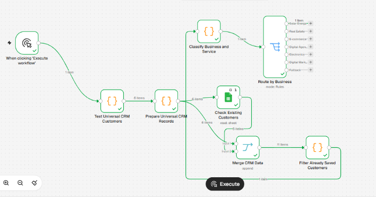
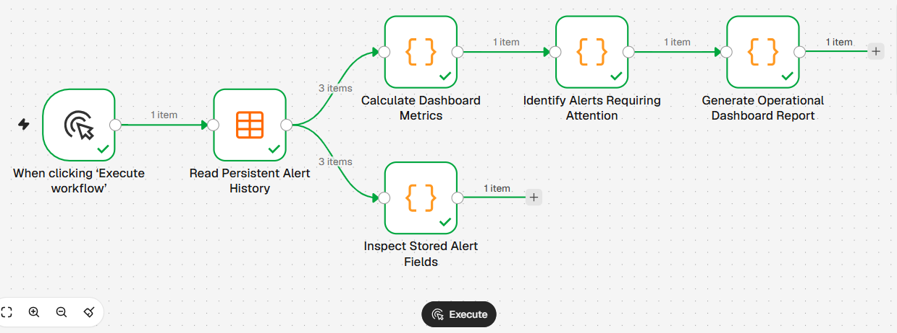
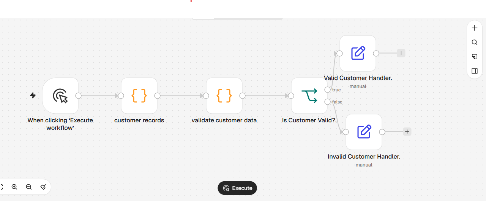
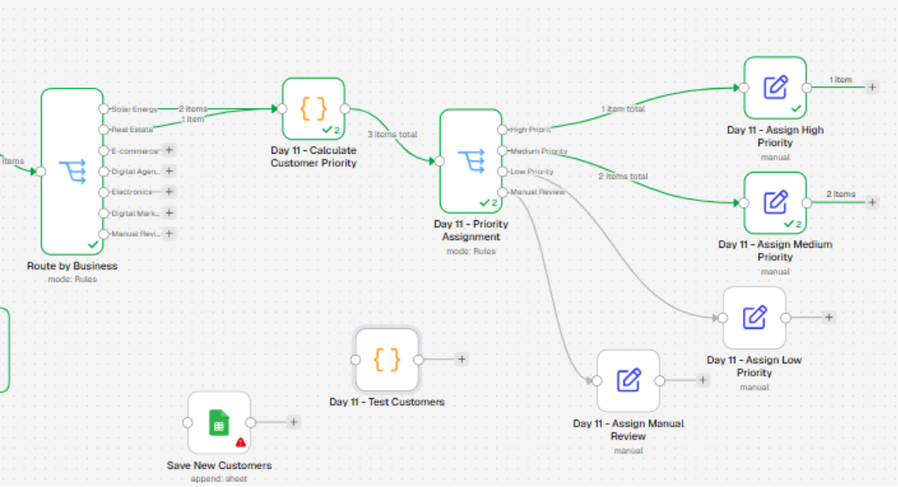
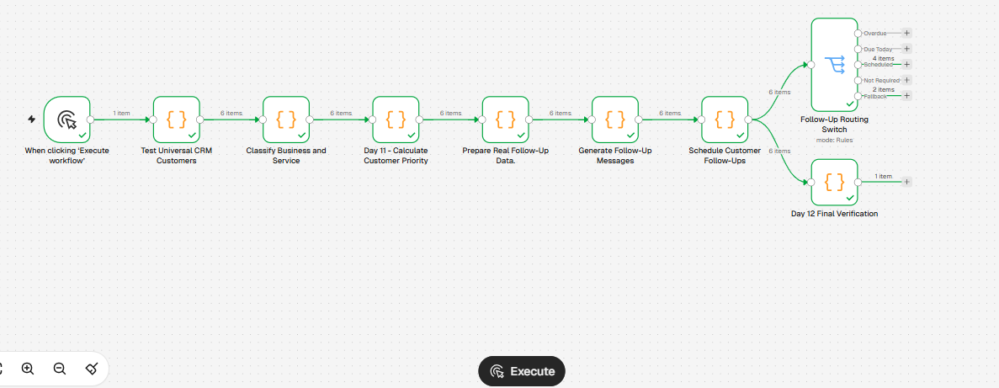
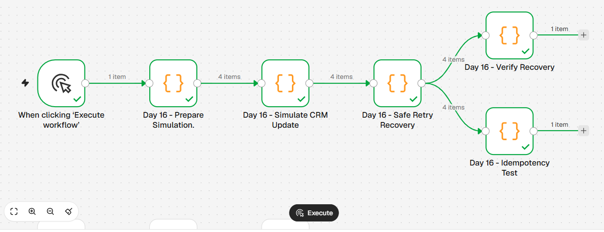

# Universal Business CRM & Alert Automation

A modular business automation system built with n8n to streamline customer enquiry processing, CRM management, lead prioritization, follow-up scheduling and operational monitoring.

Developed by **Ebiowei Peter** as an independent portfolio project demonstrating practical workflow automation, system integration and reliability testing.

## Explore the Project

- [Professional Project Case Study](docs/case-study.md)
- [System Architecture](docs/architecture.md)
- [Testing and Validation Report](tests/test-report.md)
- [Workflow Screenshots](#workflow-screenshots)
- [Download Sanitized Workflow](workflow/universal-business-crm-sanitized.json)

## Project at a Glance

| Metric | Verified Result |
|---|---:|
| Development workflow nodes | 98 |
| Connection entries | 75 |
| Baseline CRM records | 5 |
| Persistent alert history records | 3 |
| Day 25 edge-case tests | 5/5 passed |
| Broken connection references | 0 |
| Unauthorized CRM writes during final audit | 0 |
| Notifications sent during final audit | 0 |

These results were obtained using controlled development datasets, not live client operations.

## Project Overview

Businesses that manage customer enquiries manually can experience duplicate records, missed follow-ups, inconsistent customer information and delayed responses.

This project demonstrates how n8n can automate customer data processing, business classification, lead management and operational reporting while introducing validation, duplicate protection, audit trails and controlled update mechanisms.

## Intended Business Value

- Reduce repetitive administrative work.
- Improve customer data consistency.
- Identify high-priority enquiries.
- Organize customer follow-up activities.
- Route enquiries to appropriate teams.
- Improve visibility into operational failures.
- Reduce the risk of duplicate event processing.

These are intended benefits, not measured production outcomes.

## Project Preview

### CRM Integration and Duplicate Prevention

### Operational Monitoring and Reporting

> **Deployment status:** This project is a tested development demonstration. Production deployment requires additional integration testing, configuration and security review.

## Project Overview

Businesses often manage customer enquiries manually across spreadsheets, emails and different departments. This can result in duplicate records, missed follow-ups, inconsistent customer information and delayed responses.

This project demonstrates how n8n can automate these processes while introducing validation, duplicate protection, audit trails and controlled update mechanisms.

## Key Features

- Customer enquiry validation and normalization
- Multi-business classification and routing
- Google Sheets CRM integration
- Customer deduplication using composite keys
- Automated lead priority scoring
- Department and team assignment
- Follow-up scheduling
- Automated follow-up message preparation
- Customer response tracking
- CRM update simulation
- Failure detection and retry simulation
- Duplicate event and replay protection
- Persistent alert history using n8n Data Tables
- Alert severity classification
- Escalation and notification preparation
- Operational monitoring and dashboard reporting
- Data quality and integrity validation

## Supported Business Categories

The classification system supports:

- Solar energy
- Real estate
- E-commerce
- Digital agencies
- Electronics
- Digital marketing

Unsupported businesses and services are routed for manual review.

Priority scoring currently includes dedicated rules for solar energy and real estate.

## Technology Stack

| Technology | Purpose |
|---|---|
| n8n | Workflow orchestration |
| JavaScript | Business logic and validation |
| Google Sheets | Customer CRM storage |
| n8n Data Tables | Persistent alert history |
| JSON | Data exchange and workflow portability |
| GitHub | Documentation and version control |

## Workflow Architecture

Customer Enquiries
→ Data Validation and Normalization
→ Duplicate Detection
→ Business Classification
→ Priority Scoring
→ Department Assignment
→ Follow-Up Management
→ CRM Update Validation
→ Failure Recovery Simulation
→ Audit Logging
→ Alerts and Escalation
→ Operational Reporting

The project contains multiple connected and standalone testing modules.

## Customer Deduplication

A composite customer key is generated using:

`business_name | email`

Business names and email addresses are normalized before comparison.

This allows the same customer to enquire about services from different businesses without being incorrectly classified as a duplicate.

Repeated enquiries within the same business can be identified and filtered.

## Priority Scoring

The priority scoring module evaluates supported enquiries using four criteria.

| Criterion | Maximum Points |
|---|---:|
| Urgency | 40 |
| Budget | 30 |
| Service category | 20 |
| Contact completeness | 10 |
| Total | 100 |

Priority levels:

- High: 70–100
- Medium: 40–69
- Low: 0–39
- Manual Review: Unsupported records

## Follow-Up Management

The workflow prepares customer follow-up tasks based on priority.

| Priority | Follow-Up Interval |
|---|---|
| High | 1 day |
| Medium | 2 days |
| Low | 3 days |

Follow-up records are classified as:

- Overdue
- Due Today
- Scheduled
- Not Required

Messages are prepared for review rather than automatically sent.

## Alert Monitoring

The monitoring system supports three severity levels:

- Critical
- Warning
- Info

Alert lifecycle states include:

- Open
- Acknowledged
- Resolved

The system also demonstrates escalation decisions, replay detection and notification audit records.

## Safety and Reliability

The project incorporates the following controls:

- Input validation
- Composite-key duplicate protection
- Restricted write authorization
- Event ID validation
- Retry limits
- Manual review routing
- Duplicate escalation protection
- Alert state transition validation
- Audit logging
- Controlled simulation of external updates

The public workflow is intentionally sanitized. External storage integrations are disabled and require configuration before execution.

## Development and Test Results

The original development workflow was tested against controlled training datasets.

| Verification | Recorded Result |
|---|---|
| Workflow nodes | 98 |
| Baseline CRM records | 5 |
| Persistent alert history records | 3 |
| Cross-execution replay detection | Passed |
| Duplicate alert detection | Passed |
| Alert state eligibility testing | Passed |
| Day 25 edge-case tests | 5 of 5 passed |
| CRM writes during final audit | 0 |
| Notifications sent during final audit | 0 |

These results reflect controlled development tests, not production deployment or performance benchmarks.

## Project Structure

    n8n-universal-business-automation/
    ├── README.md
    ├── workflow/
    │   └── universal-business-crm-sanitized.json
    ├── screenshots/
    ├── docs/
    └── tests/

## Installation and Configuration

Requirements:

- An n8n installation
- Google Sheets account
- Google Sheets credentials configured in n8n
- A suitable CRM spreadsheet
- An n8n Data Table for alert history

Setup:

1. Download the sanitized workflow JSON.
2. Open your n8n instance.
3. Create a new workflow.
4. Import the JSON file.
5. Review all nodes and connections.
6. Configure your own credentials and storage resources.
7. Use synthetic customer records for testing.
8. Validate read operations and safety controls.
9. Keep write and notification operations disabled until independently verified.

Do not execute the entire workflow immediately after importing.

## Privacy and Security

The public workflow export is prepared without the original private credential references and storage configuration.

Users must supply their own integration settings.

Never commit API keys, access tokens, real customer records or private credentials to a public repository.

## Current Limitations

- The project is a development and portfolio demonstration.
- Live CRM updates and notification delivery have not been authorized.
- Some validation rules depend on fixed training datasets.
- Sixteen historical audit warnings remain unresolved.
- Three stored alert records require severity classification.
- Atomic duplicate protection under concurrent executions has not been established.
- The sanitized workflow requires separate import and integration testing.

## Business Applications

The automation concepts demonstrated in this project can be adapted for:

- Lead management
- Customer enquiry processing
- Sales pipeline automation
- Appointment follow-up
- Customer support workflows
- Service request routing
- CRM monitoring
- Operational reporting

## Future Improvements

- Webhook-based customer enquiry collection
- AI-powered customer enquiry classification
- Gmail and WhatsApp integrations
- Database-backed CRM storage
- Atomic event processing
- Automated reporting
- Production deployment and monitoring

## Author

**Ebiowei Peter**

n8n Workflow Automation | JavaScript | CRM Automation | Business Process Automation

Open to freelance automation projects, workflow development and business process integration opportunities.

## Project Status

Development and portfolio demonstration.

Production deployment requires additional configuration, testing and security review.

## Workflow Screenshots

### 01 — Customer Enquiry Validation

Validates customer records and separates valid and invalid enquiries.

### 02 — CRM Integration and Duplicate Prevention

Retrieves existing CRM records and prevents duplicate customer entries.

### 03 — Priority Scoring and Assignment

Scores customer enquiries and assigns appropriate priorities.

### 04 — Follow-Up Automation

Prepares follow-up messages, schedules activities and routes customer records.

### 05 — Error Handling and Failure Recovery

Demonstrates safe retries, failure recovery and duplicate update protection.

### 06 — Operational Dashboard and Reporting

Retrieves alert history, calculates metrics and generates operational reports.

## Structural Audit Results

The original Day 26 workflow was inspected for structural integrity.

| Audit Check | Result |
|---|---:|
| Total workflow nodes | 98 |
| Connection entries | 75 |
| Google Sheets nodes | 5 |
| n8n Data Table nodes | 3 |
| Isolated functional nodes | 6 |
| Broken connection references | 0 |
| Duplicate node names | 0 |

The structural audit passed. Full end-to-end production readiness has not been established.

The project contains connected automation modules and standalone development and testing branches.

## Additional Project Documentation

- [Professional Project Case Study](docs/case-study.md)
- [System Architecture](docs/architecture.md)
- [Testing and Validation Report](tests/test-report.md)
- [Sanitized n8n Workflow](workflow/universal-business-crm-sanitized.json)
