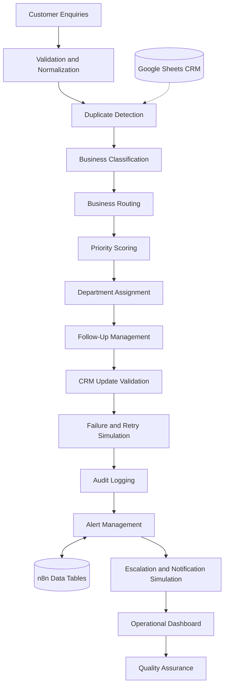

# System Architecture

## Project: Universal Business CRM & Alert Automation

## 1. Customer Processing

- Customer enquiry collection
- Input validation and normalization
- Google Sheets CRM record retrieval
- Composite-key duplicate detection
- Business and service classification
- Business-specific routing

## 2. Lead Management

- Customer priority scoring
- Department assignment
- Follow-up identification
- Follow-up message preparation
- Follow-up scheduling and routing

## 3. CRM Reliability

- Customer response tracking
- CRM update validation
- Event processing
- Duplicate event protection
- Safe update simulation
- Retry and failure recovery

## 4. Operational Monitoring

- Audit logging
- Alert severity classification
- Notification preparation
- Alert state management
- Escalation validation
- Persistent alert history
- Cross-execution replay protection

## 5. Reporting and Quality Assurance

- Operational dashboard reporting
- Missing field detection
- Invalid state detection
- Duplicate alert detection
- Empty input testing
- Integration audit

## Storage Layer

- Google Sheets: Customer CRM records
- n8n Data Tables: Persistent alert history

## Safety Controls

- Restricted CRM write authorization
- Notification simulation
- Retry limits
- Manual review routing
- Duplicate event detection
- Disabled storage integrations in the public export

## Environment

- n8n 2.45.7 (Self-hosted)
- JavaScript
- Windows 11
- JSON

## Deployment Status

This project is a controlled development demonstration.
Production integration requires additional configuration,
security review and testing.

## System Architecture Diagram

