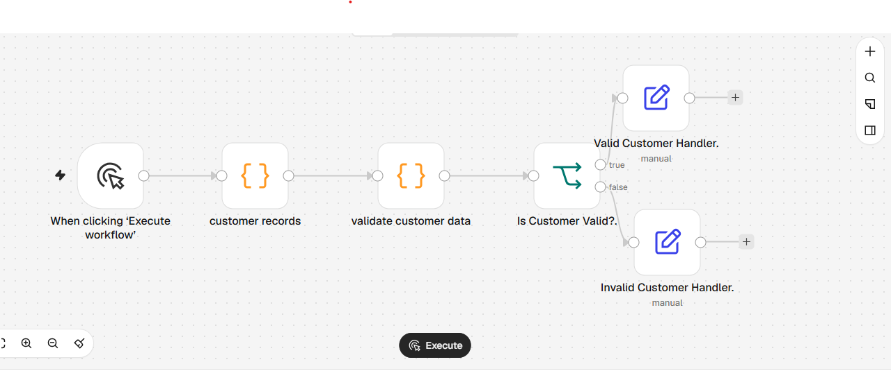
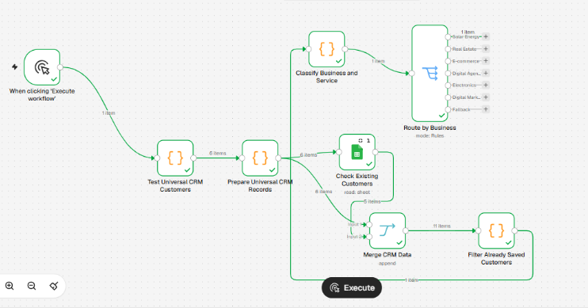
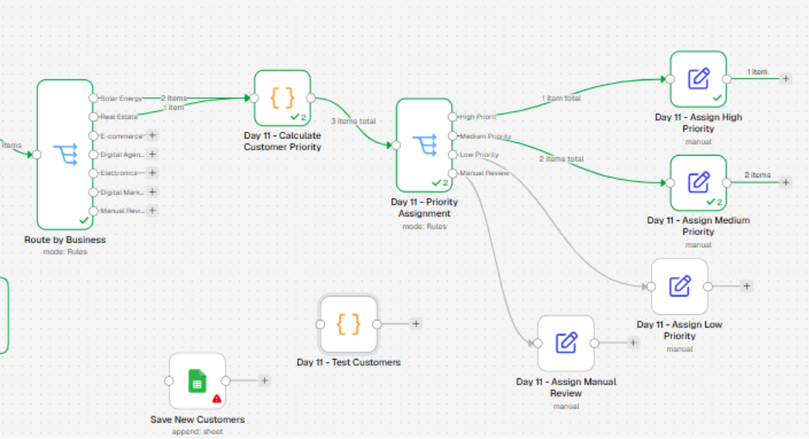
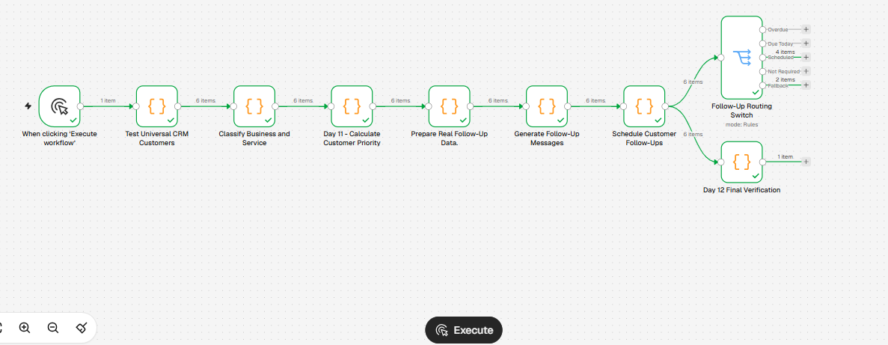
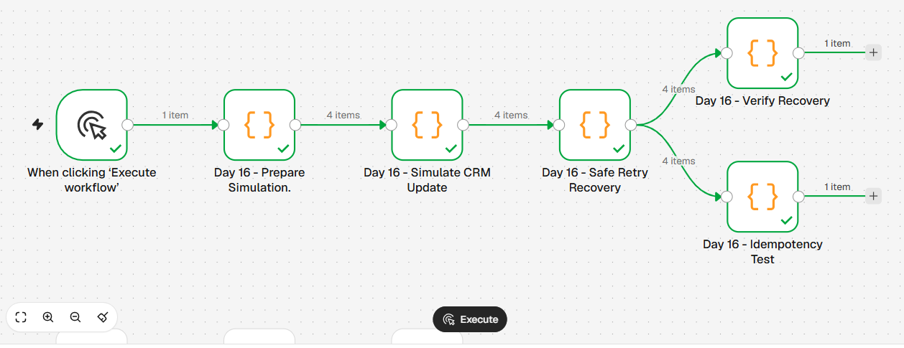
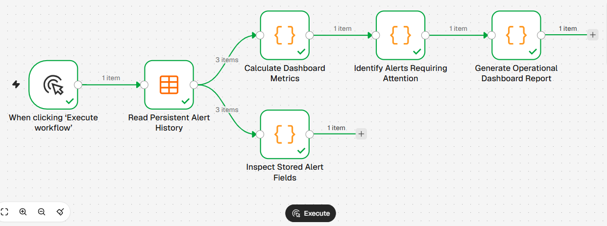

# Workflow Testing and Validation Report

## Project

Universal Business CRM & Alert Automation

## Author

Ebiowei Peter

## Testing Environment

- n8n 2.45.7 (Self-hosted)
- Windows 11
- JavaScript
- Google Sheets CRM
- n8n Data Tables
- Controlled training datasets

## Development Test Results

| Day | Test | Recorded Result |
|---|---|---|
| 9 | CRM deduplication | 5 unique baseline records |
| 10 | Business routing | Unsupported records routed to fallback |
| 11 | Priority scoring | High and medium priority routes verified |
| 12 | Follow-up scheduling | Scheduled, overdue and due-today routes verified |
| 13 | CRM update authorization | 0 authorized writes |
| 14 | Event processing | Duplicate protection verified |
| 15 | CRM history integration | 5 matched CRM records |
| 16 | Failure recovery | Retry limits and idempotency verified |
| 17 | Audit reconciliation | Passed; 16 warnings remain |
| 18 | Alert classification | 1 critical, 2 warnings, 1 info |
| 19 | Alert state monitoring | 4 unique alerts |
| 20 | Escalation validation | 3 valid transitions, 2 rejected |
| 21 | Notification audit | 2 prepared, 2 skipped, 1 rejected |
| 22 | Replay protection | 3 replay attempts blocked |
| 23 | Persistent alert history | 3 stored records; replay checks passed |
| 24 | Operational dashboard | Report validation passed |
| 25 | Edge-case testing | 5 of 5 tests passed |
| 26 | Integration audit | 98 nodes; documentation and backup saved |

## Day 26 Structural Audit

| Audit Check | Result |
|---|---:|
| Total workflow nodes | 98 |
| Connection entries | 75 |
| Google Sheets nodes | 5 |
| n8n Data Table nodes | 3 |
| Isolated functional nodes | 6 |
| Broken connection references | 0 |
| Duplicate node names | 0 |

## Day 24 Operational Dashboard Results

| Metric | Result |
|---|---|
| Total alerts | 3 |
| Open alerts | 1 |
| Acknowledged alerts | 1 |
| Resolved alerts | 1 |
| Unresolved alerts | 2 |
| Unknown severity | 3 |
| Resolution rate | 33.33% |
| Dashboard status | ATTENTION_REQUIRED |
| Report validation | Passed |

## Day 25 Quality Assurance

- Missing field detection: Passed
- Invalid field detection: Passed
- Duplicate alert detection: Passed
- Empty input and invalid state tests: 5 of 5 passed

## Final Safety Baseline

| Safety Check | Result |
|---|---:|
| Google Sheets CRM records | 5 |
| Persistent alert history records | 3 |
| CRM writes during final audit | 0 |
| Notifications sent during final audit | 0 |

## Visual Test Evidence

### Customer Validation

### CRM Integration

### Priority Scoring

### Follow-Up Automation

### Failure Recovery

### Operational Reporting

## Outstanding Issues

- 16 historical audit warnings remain unresolved.
- 3 stored alert records lack severity information.
- Atomic duplicate protection under concurrent executions has not been established.
- Live notification delivery has not been verified.
- Some validation logic depends on controlled training datasets.
- The sanitized workflow requires separate import and integration verification.
- Production deployment has not been performed.

## Conclusion

The project demonstrates practical skills in workflow automation, customer data management, CRM integration, conditional routing, failure recovery, persistent storage and operational monitoring.

Recorded development tests demonstrate the behaviour of individual automation modules under controlled conditions.

These results do not constitute production certification, load testing or a guarantee of production readiness.

## Project Documentation

- [Main README](../README.md)
- [System Architecture](../docs/architecture.md)